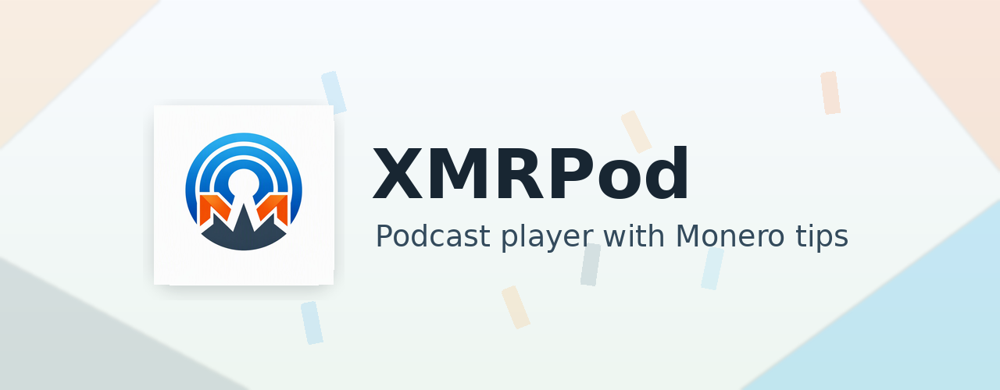

<p align="center">
  
</p>

<p align="center">
  <a href="https://f-droid.org/packages/com.xmrchat.xmrpod/">
    
  </a>
</p>

# XMRPod

XMRPod is an open-source podcast app for Android with Monero tipping support for creators on XMRChat. No tracking, no analytics, no ads.

XMRPod is a fork of the excellent [AntennaPod](https://github.com/AntennaPod/AntennaPod), the open-source podcast player built by its community of contributors. XMRPod keeps AntennaPod's podcast features and adds its XMRChat tipping and live stream support on top.

## Monero Tipping

XMRPod adds a `Tip` action to the playback screen for podcasts whose creators have an XMRChat page. When you send a tip, XMRPod creates a tip payment address with the listener name, amount, and optional message, then hands the payment URI to a compatible Monero wallet such as Cake Wallet.

## Making Your Podcast Tippable

XMRPod detects tippable podcasts by matching URLs locally on the listener's device — no special tags are added to your feed. Register one or both of these links on your XMRChat page:

### 1. `podcast-rss` (recommended)

Add a Content Link on your XMRChat tip page for your feed URL, for example `https://example.com/feed.xml`. XMRPod compares it against the URL your feed is served from, so this is the most reliable match.

### 2. `website` (fallback)

Add a Content Link on your XMRChat tip page for your site URL, for example `https://example.com`. XMRPod compares it against the website link declared inside your feed:

RSS 2.0 — the channel-level `<link>` tag:

```xml
<channel>
  <link>https://example.com</link>
</channel>
```

Atom — a feed-level alternate HTML link:

```xml
<link rel="alternate" type="text/html" href="https://example.com"/>
```

If the `podcast-rss` link matches, it wins and the website check is skipped.

Matching ignores case, `www.` prefixes, query strings, `#fragments`, and trailing slashes — everything else must match exactly. A website URL claimed by more than one XMRChat page is ignored, so listeners never tip the wrong creator. The page list is cached and refreshed at most every 15 minutes, so new registrations can take a moment to appear.

## Live Streams

When a podcast's creator is live, XMRPod shows a `LIVE` row at the top of the podcast's episode list. Tap it to watch the stream right inside XMRPod, go fullscreen, and send a Monero tip with the `Tip` button while you watch.

- Works with streams on Twitch, Kick, YouTube, Rumble, and PeerTube.
- Keeps playing while you browse XMRPod, use another app, or turn the screen off.
- Pause, resume, or stop the stream from Android's media controls, and tap the notification to return to the player.
- Starting a podcast episode or disconnecting headphones pauses the stream.

Live status is checked when you open a podcast's page and refreshed every few minutes while it stays open.

Some streams may still pause or stall with the screen off, depending on the streaming provider and your Android WebView version.

### Showing Your Live Stream in XMRPod

Live streams use the same matching as tips. Once your podcast is tippable (see [Making Your Podcast Tippable](#making-your-podcast-tippable)), add your Twitch, Kick, YouTube, Rumble, or PeerTube channel to your XMRChat page. When XMRChat sees you live, XMRPod listeners get the `LIVE` row on your podcast page automatically.

## Live Stream Notifications

Get a notification when a podcast you follow goes live. Tap the bell on a podcast's page to turn on alerts for that podcast. The bell shows on subscribed podcasts that have an XMRChat page, and it starts off.

The first time you turn on a bell, XMRPod sets up notifications for you. It picks your push app, registers it, and sends a test notification so you know it works. You only choose a push app yourself if you have more than one.

- You need a UnifiedPush app such as [Sunup](https://f-droid.org/packages/org.unifiedpush.distributor.sunup/). If you don't have one, XMRPod offers to install Sunup. Open Sunup once and finish its setup.
- Until push notifications work, XMRPod checks for live podcasts about once an hour instead, so alerts can come late or miss short streams.
- Tap a notification to open the podcast's page. Playback doesn't start on its own.
- Check the status, send a test, or retry setup in Settings → Notifications. New episode notifications work the same as before.

## Privacy

Discovery happens entirely on your device. XMRPod downloads a single generic list of public XMRChat creator pages and matches your subscribed feeds against it locally. Your podcast titles, feed URLs, and listening activity are never transmitted.

The only network calls XMRPod makes:

- One generic download of the public creator page list (cached, refreshed at most daily).
- A public Monero price fetch when you open the tip form.
- The tip request — only when you explicitly send a tip. It carries just the tip details plus a `source=xmrpod` marker.
- One generic download of the list of creators who are live right now, when you open the page of a podcast that has an XMRChat page. It never says which podcast you are viewing.
- When you turn on notifications, an anonymous registration with XMRChat's notification server, renewed once a day, plus test notifications. XMRPod gets alerts for every creator who goes live and keeps only the ones for your podcasts on your device, so your subscriptions are never sent.
- Until push notifications work, the same generic live list download about once an hour, only while at least one bell is on.
- The streaming provider's embedded player (Twitch, Kick, YouTube, Rumble, or PeerTube) — only when you choose to watch a live stream. That provider sees your connection the same way it would on its own website.

## Package Name

Release builds use:

```text
com.xmrchat.xmrpod
```

Debug builds use:

```text
com.xmrchat.xmrpod.debug
```

## Building

Build a debug APK with:

```sh
./gradlew :app:assembleDebug
```

Debug APKs are written under:

```text
app/build/outputs/apk/
```

## Releases

Release notes come from [CHANGELOG.md](CHANGELOG.md), not from generated commit summaries.

To publish a new XMRPod release, add a new topmost `## [version] - YYYY-MM-DD` section to `CHANGELOG.md`, run the release metadata step locally, commit the result, and push it to `develop`.
GitHub Actions will read the latest changelog version, create the `xmrpod-vversion` tag if it does not exist, build the Free release APK, and publish a GitHub release that links back to the full changelog.

You can run the release metadata step locally with:

```sh
python3 scripts/update_changelog_release.py
```

## License

XMRPod is licensed under the GNU General Public License, version 3. See [LICENSE](LICENSE).
